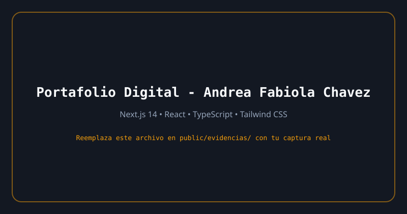

# Portafolio Digital – Andrea Fabiola Chávez Rivas

Portafolio web profesional desarrollado con **Next.js 14**, **React**, **TypeScript** y **Tailwind CSS**, recopilando los proyectos y aprendizajes de las 10 semanas de Algoritmos, Inteligencia Artificial, Machine Learning y Desarrollo Web.

## Vista Previa


## Enlace en Producción
👉 [Ver portafolio en Vercel](https://portafolio-fabiola.vercel.app) *(Actualiza este enlace con tu URL real de Vercel)*

## Tecnologías Utilizadas
- **Frontend:** Next.js 14 (App Router), React 18, TypeScript, Tailwind CSS, Lucide Icons, Next Themes
- **Backend:** API REST con Route Handlers (`POST /api/contact`)
- **IA y Ciencia de Datos:** Python, Scikit-Learn, Pandas, NumPy, Matplotlib
- **Despliegue y Control de Versiones:** Git, GitHub y Vercel

## Instalación y Ejecución Local
1. Clonar el repositorio:
   ```bash
   git clone https://github.com/TU-USUARIO/mi-portafolio-digital.git
   cd mi-portafolio-digital
   ```
2. Instalar dependencias:
   ```bash
   npm install
   ```
3. Crear archivo `.env.local` en la raíz con:
   ```env
   CONTACT_EMAIL=tu-correo@gmail.com
   NEXT_PUBLIC_SITE_URL=http://localhost:3000
   ```
4. Iniciar en modo desarrollo:
   ```bash
   npm run dev
   ```
5. Abrir [http://localhost:3000](http://localhost:3000) en el navegador.

## Aprendizajes del Período
Durante estas 10 semanas integré algoritmos de Machine Learning (Regresión Lineal, Árboles de Decisión, K-Means y KNN) con el desarrollo de aplicaciones web full-stack, implementando validación de formularios en cliente y servidor, arquitectura modular y despliegue continuo en producción.
